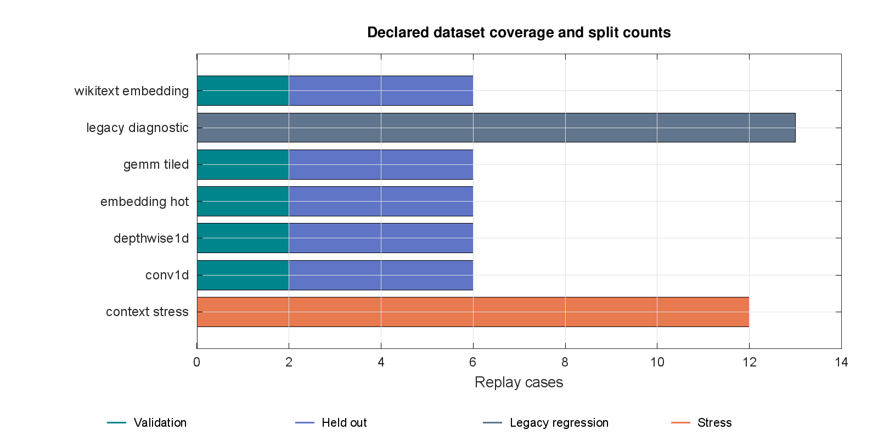
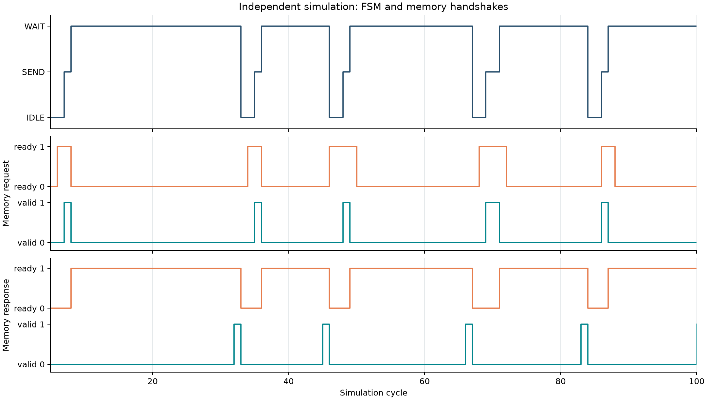
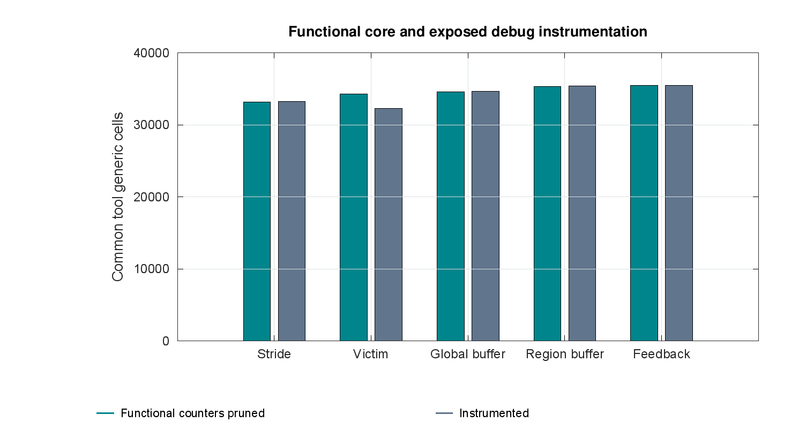
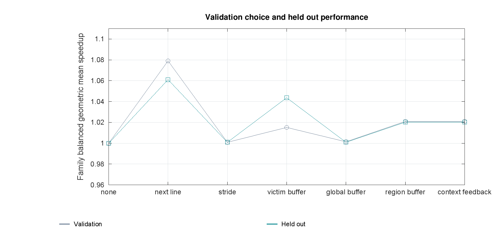
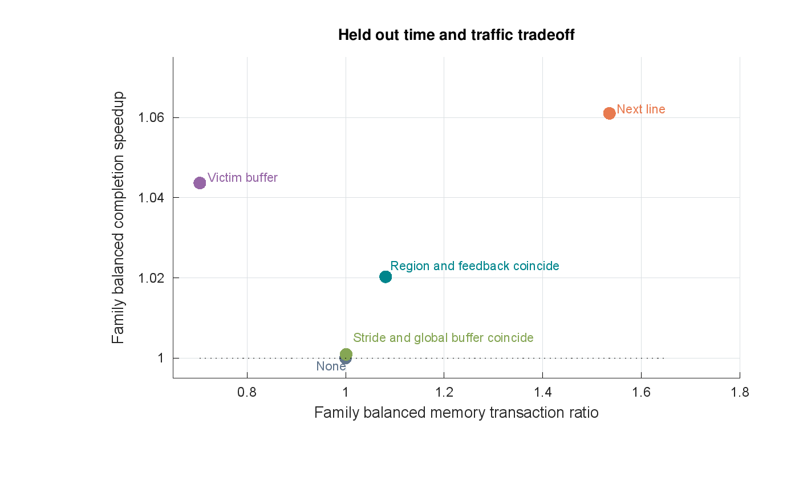
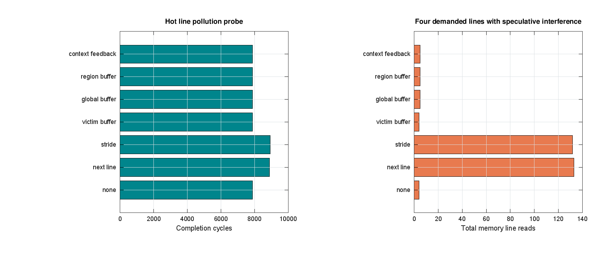
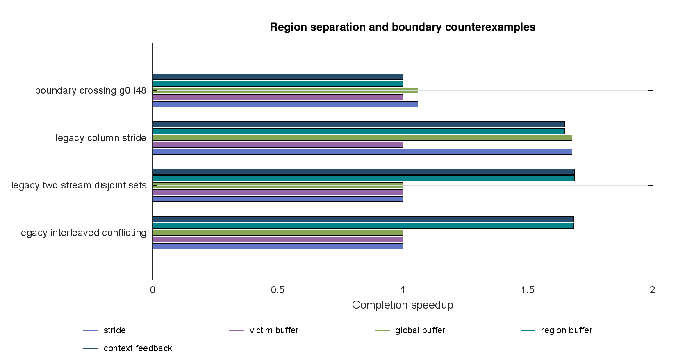

# Final hackathon technical report

## Context Aware Cache and Prefetch Engine

https://github.com/presish1/micron-context-aware-cache

Final technical report for the Micron RTL hackathon. The project follows all five challenge levels, starting with a reproducible Phase 1 baseline and testing a bounded Phase 2 upgrade through matched RTL experiments.

The strongest mechanism result is conditional. Four regional histories reduce conflicting-stream completion from 21,258 to 12,626 cycles, a 1.684x speedup, with 514 versus 512 memory reads. A separate speculative buffer repairs the demonstrated hot-line pollution failure.

The broader evidence challenges complexity: the declared validation rule selects region history without feedback, while the demand-only victim control achieves better time and traffic on the held-out kernel/lookup aggregate. The final contribution is a verified integration, causal ablations and transparent operating limits.

| Team member | Programme and identifier | Department |
|---|---|---|
| Presish Gautam | B.Tech, 3rd year; GE26Z817 | Data Science and AI |
| Nitesh Kumar Shah | M.Tech, 2nd year; ID25M806 | Data Science and AI |

385 primary runs, 20 validation sensitivity runs, 338,232 benchmark response checks. Report date 1 November 2026. The public repository contains final artifacts, sources, raw measurements and reproduction instructions.

## Design Thinking and the Memory Problem

Empathize with an accelerator designer: compute can wait for operands, yet speculative traffic can consume service time or displace reusable data. Micron’s official AI material describes bandwidth, capacity, latency and power as workload-dependent constraints. That motivates useful data movement, without validating this particular controller [1].

Define success as lower demand completion time under a declared traffic and resource budget. Ideate through separate mechanisms: isolate speculative placement, preserve independent histories, gate waste and compare an alternative use of the same extra data capacity. Prototype the smallest controller whose returned data can be checked. Test positive cases, held-out replays and mechanism-specific counterexamples.

Stream buffers, table-based prediction and feedback have extensive prior art [2-4]. Regional history is an address-only proxy with less information than a per-instruction predictor such as Berti [5]. The work does not claim invention of buffering, adaptive prefetching or a general AI policy.

| Question | Falsifiable evidence |
|---|---|
| Does placement repair pollution? | Hot-line case with identical demands and extra miss accounting |
| Does context repair mixed histories? | Global-buffer versus region-buffer ablation |
| Does feedback earn its cost? | Region-only versus gate, including recovery and regressions |
| Is extra storage the explanation? | Demand victim buffer with the same32 extra data bytes |

## Level One Dataset Quality and Provenance

The suite contains 55 replay cases: 13 known Phase 1 diagnostics, 24 complete numerically checked kernel cases, 6 authentic-input lookup cases and 12 timing/context stress cases. Kernel families are tiled GEMM, convolution1D, depthwise1D and skewed embedding pooling. Independent numerical formulations cross-check outputs before their immutable operand reads are replayed.

Seed 11 supplies validation; shape/layout seeds 101 and 202 supply a limited holdout at gaps 0 and 12. WikiText2 published train/validation/test snapshots provide 256 whitespace tokens each. A fixed BLAKE2b modulo 65,536 map supplies lookup IDs for modelled eight-word embeddings. The train snapshot supports validation; validation/test snapshots support holdout. Hash collisions and exact source content hashes remain in the manifest.

These are small deterministic workloads, not production-calibrated model captures. The corpus contributes authentic repetition, while tensor layout, arithmetic and timing remain modelled. The source API is live, so exact checksums reject drift. Raw source text is excluded from redistribution; the manifest links its dataset card and notes inconsistent upstream license metadata.

## Level Two Architecture and Resource Budget

The demand cache stores 64 direct-mapped lines of 16 bytes, retaining the baseline 1 KiB data capacity. A 32-bit aligned byte address supplies a 28-bit line identity, a six-bit index and a two-bit word selector. Address 0x1234 selects line 0x123, index 35 and word 1. Full line identities deliberately retain redundant index bits for inspection.

Two fully associative entries keep speculative data outside the demand cache. A demand can consume a buffered line immediately, promote it into the cache, or queue behind an in-flight speculative transfer and recheck afterward. Candidates already cached or buffered are filtered. All memory transfers return a complete 128-bit line.

The demand-only victim control uses the same extra 32 data bytes for displaced demand lines, including swap-on-hit. It has different metadata and control, so it is a same-data-capacity comparison rather than an equal-area proof.

| Logical structure | Stored bits before optimization |
|---|---|
| Main cache data | 64 x128 =8,192 |
| Main line identities and valid | 64 x29 =1,856 |
| Two buffer lines and identities | 2 x(128+28+1) =314 |
| Four regional entries | 4 x(1+20+28+29+2) =320 |
| Regional pointer and candidate registers | 2+29 =31 |

Controller, response, global quality/probe state and debug counters add further bits. Generic synthesis reports actual optimized cells separately. Writes, coherence, multiple outstanding reads and bus faults remain outside the interface.

## Level Three Regional Prediction and Control

A region key is line number shifted right by 8, corresponding to 4 KiB. Up to four fully associative histories retain last line, signed delta and two-bit confidence. An unseen region uses an invalid entry or round-robin replacement. Consecutive observations of the same line do not train another delta.

On an accepted distinct-line demand, a new delta is compared with that region’s stored stride. A changed nonzero delta starts confidence at 1. A repeated delta increments it, saturating at 3. A candidate qualifies when the old confidence is at least 1, so two equal deltas are required. Signed 30-bit prediction arithmetic rejects underflow and addresses beyond the 28-bit line range.

Prediction degree is one and lookahead is one stride. Triggering occurs on accepted demands, including hits. Demand selection wins in IDLE, but a speculative transaction already in SEND or WAIT cannot be preempted. Runtime disable stops new selection while preserving history training and resident buffer consumption.

| Interleaved accepted lines | Regional confidence after | Candidate |
|---|---|---|
| 100 in A,1100 in B | 0 each | None |
| 104 in A,1104 in B | 1 each | None |
| 108 in A,1108 in B | 2 each | 112 and1112 |

The optional global outcome counter rewards first consumption and penalizes unused replacement. It excludes resident unresolved lines and permits a recovery probe after 16 accepted demands at quality zero. This coarse gate is not a calibrated utility estimator.

## Level Four FSM and Protocol Ownership

The typed two-bit FSM has IDLE, SEND and WAIT. IDLE rechecks pending demand against cache and buffer before selecting a memory transfer. SEND holds the registered line and transaction identity through backpressure. WAIT accepts exactly that transaction’s response, inserts its data into the correct storage structure and returns to IDLE.

CPU acceptance is blocked by pending demand, an occupied stalled response register or a memory-fill edge. The fill-edge exclusion prevents competing array updates. A response stays valid with stable data until consumption. There is at most one accepted but unconsumed demand and at most one memory transaction. A new request can replace a concurrently consumed response without violating that bound.

Synchronous shared reset cancels both endpoints and clears valid/control state. Payload arrays retain unknown values behind cleared valid bits, and Icarus tests exercise that masking. No asynchronous CDC exists inside the module; a board adapter must supply synchronized startup and any required foreign-domain crossings.

## Level Four Verification and Assertion Evidence

The primary verification suite executes 20 directed/seeded runs and checks 96,039 demand responses. Directed cases cover pollution isolation, duplicate filtering, buffer replacement, gate closure, recovery probes, disable, shared reset in SEND/WAIT, late consumption and victim swapping. Continuous/adversarial tests vary all four upgrade/control configurations over two seeds.

A second memory model, driver and scoreboard execute eight Icarus configurations/seeds plus a Verilator run with 12 concurrent SystemVerilog properties. They check 35,982 returned demands and account for 18 reset-canceled demands. Every run visits all legal FSM transitions. Request and response payloads remain stable under stalls, duplicate residency is forbidden, and prefetch fates conserve after draining.

The independent data function is (byte address shifted right by two) XOR 0xcafe1234. It does not depend on the cache’s returned contents. Verilator strict RTL lint passes four configurations with one narrow reviewed waiver: address bits 1: 0 are unused under the aligned-word contract. Width conversions and probe bounds are explicit.

| Evidence | Status |
|---|---|
| Main RTL regression | 96,039 returned responses pass |
| Independent memory and SVA | 35,982 responses pass;18 explicit reset cancellations |
| Benchmark data checking | 338,232 responses across primary and sensitivity runs |
| FSM legal edges and held payloads | Procedural monitor and12 concurrent assertions |
| Formal proof or coverage closure | Not performed |

Counts describe checking activity, not independent samples or exhaustive correctness. Hardware debug counters are 32 bits and can wrap; benchmark accumulators are 64 bits and these runs remain below wrap limits.

## FPGA Flow and Measured Generic Cost

The repository supplies AMD xsim simulation Tcl and a non-project Vivado characterization flow. The latter requires an explicitly installed FPGA part, sets a default 10 ns characterization clock, times synchronous reset and records I/O-delay assumptions. It reports utilization, unconstrained paths, methodology and DRC, with optional placement/routing. It has no guessed board pins or bitstream claim [6].

Vivado, xvlog, xelab and xsim are not installed on the authoring host. Those scripts were not executed. Icarus/Verilator simulation and Yosys 0.70 structural checks are actual executed evidence. Ten common-tool syntheses cover five variants in functional and instrumented views. Functional wrappers disconnect debug statistics.

The region functional core uses 35,348 generic cells versus 33,193 for the baseline stride, a 6.49% increase. Victim and feedback cores use 34,303 and 35,434. Generic mapping is heuristic: exposing debug counters can change optimization enough that the instrumented victim total is lower than its functional total. Treat each view as a measured implementation, not a monotonic instrumentation-cost formula.

## Level Five Mathematical Measurement Contract

Let N be accepted demand accesses, H main-cache hits and B timely buffer hits. The retained miss counter includes buffer hits, so H+misses=N and initially unavailable demands=misses-B. Publish H/N and(H+B)/N separately. A late consumed speculative fill remains an initial miss.

Completion C ends at consumption of the last demand response and excludes an unused final compute gap. Quiescence separately drains outstanding work. Offered latency includes acceptance waiting, while accepted latency starts at the handshake. Per-request p95 uses nearest rank ceil(0.95N), not a percentile of run means.

Main cache hit rate = H / N

Immediate service rate = H + B / N

Speedup = Cbase / Cpolicy

Read ratio = Dpolicy / Dbase

P = timely + late + unused replaced + resident unresolved

G = exp(mean over families(mean over cases(log(speedup))))

First average log speedups within each family, then average across families. Geometric means, case totals and averages answer different questions. The suite is deterministic; changing gap or layout can create correlated replays, so no population confidence interval is asserted.

## Frozen Validation Choice and Holdout

The predeclared rule chooses among victim, global-buffer, region-buffer and region-feedback variants using validation only: maximize family-balanced geometric-mean speedup while keeping the corresponding traffic ratio at most 1.25. A rounded numerical tie favors the simpler declared order. The selected region variant scores 1.020954 speedup at 1.168112 traffic on validation.

Feedback ties region-only exactly on validation and held-out aggregate results, so its additional logic is disabled in the selected design. Probe intervals 8 and 32 are validation-only sensitivity runs and do not alter the frozen interval 16. The selection file hash is identical before and after held-out execution.

This is a limited experiment, not an optimality theorem. The eligibility set, objective and traffic budget are declared design choices. A different workload mixture, resource budget or latency objective can select another variant.

## Held Out Time and Traffic Results

Across 20 held-out cases from five families, the victim control reaches 1.043631 family-balanced speedup with 0.704224 traffic. Region reaches 1.020251 with 1.081294 traffic. The victim control therefore dominates region on these two held-out aggregate quantities. Next-line reaches 1.061016 but costs 1.535516 traffic and has three slowdown cases.

The holdout contains known kernel families at reserved shapes/layouts and two reserved corpus snapshots. It is evidence of limited transfer, not production generalization. Region and feedback have zero held-out slowdowns here, but they lose to the simpler control in the aggregate. All 55 primary cases and the complete slowdown distribution remain visible in the repository gallery.

| Variant | Held-out speedup | Read ratio | Slowdown cases |
|---|---|---|---|
| none | 1.000000 | 1.000000 | 0 |
| next line | 1.061016 | 1.535516 | 3 |
| stride | 1.000906 | 1.001131 | 0 |
| victim buffer | 1.043631 | 0.704224 | 0 |
| global buffer | 1.000906 | 1.001131 | 0 |
| region buffer | 1.020251 | 1.081294 | 0 |
| context feedback | 1.020251 | 1.081294 | 0 |

## Causal Repair of Pollution and Mixed Histories

In the hot-line probe, the original stride policy fetches 0x1400 after a short regular sequence and evicts hot 0x1000 at the same direct-mapped index. The original 320 demand reads touch only four lines. Stride needs 132 memory reads and 8,927 cycles; the separate region buffer needs five reads and 7,888 cycles. The victim control reaches four reads and 7,888 cycles.

In conflicting interleaved streams, global stride and global-buffer each take 21,258 cycles. Region-buffer takes 12,626 cycles, with 514 versus 512 reads. This comparison isolates history separation from buffer placement. In the disjoint-set stream probe, region similarly takes 12,695 versus 21,417 cycles.

The buffer repairs one harmful placement path, but it does not remove every prefetch cost. A selected transfer can still delay unrelated demand, and a predictor can still waste reads. Unused buffer replacement alone is waste evidence; it is not proof of demand-cache pollution.

## Counterexamples and the Feedback Decision

Region boundaries can erase a useful history. Column-stride completion changes from 12,573 cycles with global history to 12,806 with regional history. Same-region objects share one tracker. More active regions than table entries cause replacement. Changing address allocation can therefore change predictor behavior without changing the algorithm.

The global quality counter omits benefit magnitude and couples outcomes across regions. Resident lines are unresolved; a late consumed line can save little time; an accurate selected transfer can block a critical unrelated demand. The gate is a bounded heuristic rather than a utility optimizer. It reduces some known burst waste but adds no measured validation or held-out aggregate value.

The evidence supports two useful operating choices: regional prediction for separable regular streams and demand victim retention for conflict/reuse-heavy access. A future combined policy must earn its added logic on new reserved data. Choosing it after observing the present holdout and presenting the same holdout as untouched validation would be invalid.

## Low Rank CDM Research and the Cache Connection

The supplied notes and Seshadri et al. define context-dependent choice through the alternatives in an available set S [7]. Target/context factors represent interactions with other available alternatives. Standard fixed CDM scores do not change with cache telemetry when the legal policy set remains fixed. That is a mathematical mismatch with a claim of an adaptive hardware selector.

The separate reference reproduces six supplied illustrative choices at ranks 1,2,3. Mean NLL values are 0.750970,0.742501,0.753631 for hand-selected initial factors. These are not trained models or held-out cache-policy predictions. Factor storage is 2nr numeric entries versus n squared dense entries; it excludes gradients, optimizer state and quadratic intermediate matrices.

The rank bound applies to M=TC transpose. Excluding self-interactions or zeroing the diagonal can change matrix rank. Stored entries are not identifiable degrees of freedom. With only three fixed policy alternatives, large low-rank storage savings are not a persuasive hardware case.

u(x,z) = t(x)ᵀ c(z),  x ≠ z

For a choice x in set S, its score is the sum of u(x,z) over the other available choices z. The probability of x is exp(score(x,S)) divided by the sum of exp(score(y,S)) over all y in S. A legitimate cache extension adds a telemetry feature term, such as w(a) transpose phi(c). It needs labels, training/validation splits, quantization, a deployable feature path and comparison with a simpler threshold selector. No trained CDM policy is implemented in this RTL.

## Two Pass Audit and Engineering Disposition

The first pass challenged the baseline across 18 research, architecture, dataset and evidence issues. The second pass used separate arithmetic code rather than importing benchmark metric functions, and a separately written memory/driver/scoreboard rather than reusing the original memory model. These are independent checking methods, not an external certification.

The arithmetic audit checks 385 raw primary rows, 55 matched input sets, 28 aggregate rows, p95 samples, source and input hashes, fate conservation and the validation selection seal. MATLAB-compatible calculations executed in GNU Octave 11.3.0 agree on all 28 validation/held-out aggregate quantities. Native MATLAB execution remains unverified.

| Layer | Disposition |
|---|---|
| Context claim | Narrowed to region history; global feedback optional |
| Pollution and event ordering | Repaired path, directed cases and independent data checks |
| Dataset and fairness | Expanded and hash-locked, limited holdout documented |
| Novelty and company relevance | Prior art and Micron motivation cited, no endorsement |
| FPGA implementation | Vendor scripts supplied; xsim, routed timing and board gates open |
| Broad superiority | Rejected by held-out victim-control counterexample |

Residual limits are substantive: serial demand timing, one memory transaction, small read-only kernels, no physical DRAM command model, no formal proof, no device power measurement and no organizer acceptance guarantee.

## Questions for the Engineering Review

What is context? The 4 KiB address region preserves a local history; mature outcomes drive a separately evaluated global gate. There is no tensor or PC input.

Why a separate buffer? It prevents speculative fills from replacing demand lines. The original pollution probe and directed placement checks establish that repair.

Does extra storage explain everything? No: global-buffer and victim controls isolate alternative uses of the same 32 extra data bytes. Metadata and logic cost still differ.

Why not enable feedback by default? It ties the regional design on validation and holdout while adding cost. It remains an ablation until new evidence justifies it.

Is region always faster? No. It retrains at boundaries and cannot separate objects within one region. Column stride provides a measured regression.

Why does the victim control win the holdout? The declared kernels and lookups contain reuse/conflict opportunities that favor retaining demand data over speculation.

Are these real inference speedups? No. Numerical kernels generate modelled immutable operand reads; authentic tokens drive a modelled lookup layout. RTL returns deterministic backing words.

Did Vivado and MATLAB run? Native Vivado/xsim and MATLAB were unavailable. Icarus, Verilator, Yosys and GNU Octave were actually executed.

What is novel? The claimed contribution is a compact verified integration with causal ablations and full evidence. Buffer, table and feedback techniques have prior art.

What comes next? Capture application traffic with realistic concurrency, pin a DRAM timing configuration, execute vendor timing/board gates and reserve new evaluation workloads.

## Reproduction and Primary References

Run make -C Phase2 test, independent and benchmark. The corpus fetch is explicit and checksum-verified. Run prepare_data.py before the MATLAB-compatible figure function. The full command records, measured CSVs, source hashes and plot source are retained. Scientific figures describe finite subsystem measurements or clearly labelled analytical sensitivity.

The 18-figure gallery includes all-case heatmaps, family comparisons, request-tail latency, prefetch fates, pollution, boundary timing, feedback traces, transaction-penalty sensitivity, dataset coverage, incremental ablations, FSM samples and synthesis cost. J(lambda)=C+lambda*D expresses a declared preference over cycles and transactions; it is not an energy or physical-memory model.

[1] Micron AI data center, official living page: https://www.micron.com/markets-industries/ai/ai-data-center

[2] Jouppi, ISCA1990, stream/prefetch buffers: https://doi.org/10.1145/325164.325162

[3] Chen and Baer, IEEE TC1995, hardware prediction: https://homes.cs.washington.edu/~baer/chenieee.pdf

[4] Srinath et al., HPCA2007, feedback directed prefetching: https://hps.ece.utexas.edu/pub/srinath_hpca07.pdf

[5] Berti, MICRO2022, local timely deltas: https://webdiis.unizar.es/~chus/pubs/berti/berti.html

[6] AMD UG900 simulator reference, UG901 FSM registers and UG949 startup guidance; exact links in Phase2/level 4/vivado/README.md.

[7] Seshadri, Peysakhovich and Ugander, ICML2019: https://proceedings.mlr.press/v97/seshadri19a.html. Supplied Nitesh Kumar Shah draft Learning from Comparison Data, 2026, sections 4.4-4.6.

The source review also discusses newer primary preprints, MLCommons, ChampSim, Ramulator and DRAMPower. Those external systems were not run here. AI assistance contributed to engineering, analysis and presentation; the team should understand and defend every claimed result.
