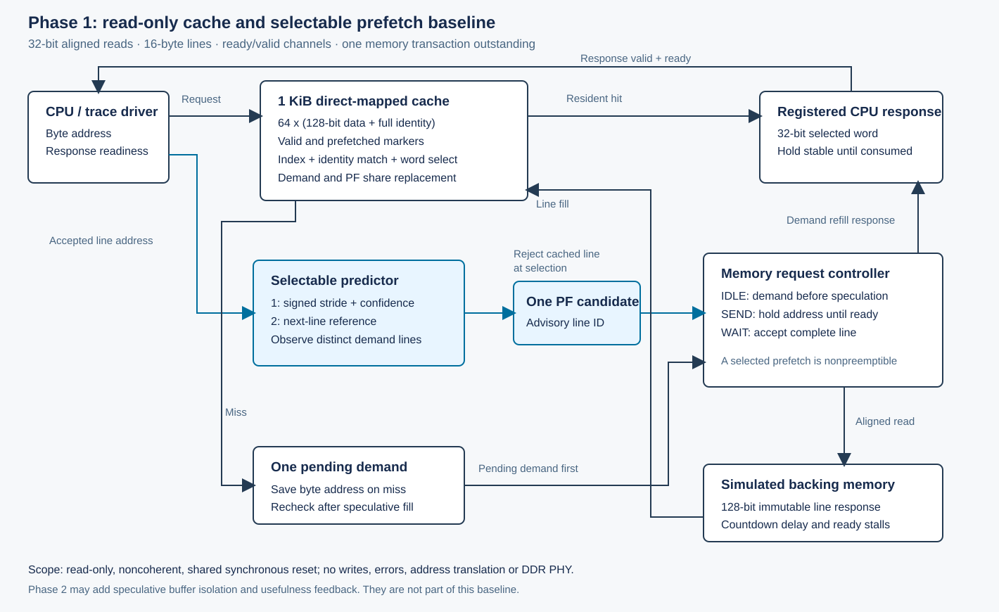

# Level 2: design and exercise the cache

This level contains a usable cache-design foundation: the specification, visible
block diagram, a demand-only software model, regression tests and a worked
notebook. Start with [cache_architecture.ipynb](cache_architecture.ipynb) to change
addresses and see placement, hits, evictions and returned words. Read the
[complete cache specification](cache_specification.md) for interface and RTL
integration details.



## What we are building

| Decision | Phase 1 choice | Why this is the starting point |
|---|---|---|
| Data capacity | 1 KiB, 64 resident lines | Small enough to inspect and validate; deliberately exposes locality and conflicts |
| Cache-line size | 16 bytes, four 32-bit words | Matches the existing 128-bit memory refill datapath |
| Associativity | Direct mapped: one slot per index | Simple lookup and deterministic replacement |
| Replacement | Every incoming line replaces its indexed slot | There is only one candidate victim; LRU is unnecessary with one way |
| Write policy | Writes unsupported | Backing data must remain immutable; no dirty bits or coherence |
| Request handling | One queued demand, one memory transaction | Easy ordering and duplicate-read checks; limited overlap |
| Prefetch placement | Ordinary cache lines | Retains the baseline; wrong speculative fills can evict demanded data |

These are project choices, not organizer-mandated parameters or an optimal AI
cache claim. Level 1's archived 64-byte grouping differs from this 16-byte RTL
line; Level 5 re-analyses its inputs using 16 bytes before comparing policies.

## Decode a real address

For the default geometry:

```text
line identity = byte address >> 4
index         = line identity & 63
word offset   = (byte address >> 2) & 3
refill address = line identity << 4
```

`0x1234` selects line identity `0x123`, index **35**, word **1**, with refill
address `0x1230`. The RTL stores the full 28-bit line identity, not only the
minimum tag. A hit requires the selected slot to be valid and its full identity
to match. `0x1000` and `0x1400` both map to index zero, so they replace each other
while still returning the correct words.

Each line has 128 data + 28 identity + valid + prefetched = **158 logical bits**.
The 64-line arrays total **10,112 bits**, excluding controller, predictor and
counters. This logical count is not synthesized area, FPGA resource usage or
power. See the [actual generic synthesis evidence](../level4/synth/reference/summary.json).

## Run the model now

From the repository root:

```sh
python3 Phase1/level2/cache_model.py --demo
PYTHONPATH=Phase1/level2 python3 -m unittest discover -s Phase1/level2/tests -v
```

The demo reads `0x1000, 0x1004, 0x100c, 0x1010, 0x1000, 0x1400, 0x1000` and
shows each line, index, word, hit/miss and evicted identity. The expected demand
counts are **7 accesses, 3 hits and 4 misses**. Word reads within the first line
share a fill; the final two reads expose a direct-map conflict.

To model one generated Level 5 trace after running the benchmark:

```sh
python3 Phase1/level2/cache_model.py \
  --trace Phase1/build/benchmarks/traces/tensor_stream.csv \
  --index-bits 6 --output Phase1/build/level2/tensor_stream.json
```

The strict input is `address,gap`, with explicit `0x` byte addresses. The model
validates gaps but **ignores them**. `--index-bits 4`, `6` and `8` select 256-byte,
1-KiB and 4-KiB caches; lines remain 16 bytes. This model supports practical
index widths 1..12, while the RTL's decomposition contract is broader.

## What the model proves, and what it does not

[cache_model.py](cache_model.py) implements cold demand-only placement, full
identity checks, replacement, all four word selectors, reset and the same
address-derived backing-data convention as the RTL tests. It fills misses
immediately and has unbounded Python counters. Its `empty_slot_fill` and
`replacement_fill` labels describe a slot event; they do not classify every miss
as compulsory, conflict or capacity.

The tests regenerate all **13** Level 5 inputs and compare demand-only hit/miss
and memory-read counts with the committed no-prefetch RTL reference. That
comparison is valid because both follow the same serialized demand/residency
order without speculative fills. It does **not** compare cycles, backpressure,
prefetch effects or physical hardware latency. Those remain Level 4/5 tests.

## Files to build on

| File | Use |
|---|---|
| [cache_architecture.ipynb](cache_architecture.ipynb) | Worked address, data, conflict and geometry experiments |
| [cache_model.py](cache_model.py) | Executable untimed demand-only model and CLI |
| [tests/test_cache_model.py](tests/test_cache_model.py) | Data/mapping/reset checks and all-trace baseline count comparison |
| [cache_specification.md](cache_specification.md) | Complete design decisions, protocol, timing and limitations |
| [cache_architecture.svg](cache_architecture.svg) | Standalone block diagram |
| [cache_architecture.mmd](cache_architecture.mmd) | Editable diagram source |
| [RTL cache](../level4/rtl/ai_cache.sv) | Actual clocked hardware corresponding to the specification |

Next, vary capacity and address alignment in the notebook, record which lines
conflict, and explain the tradeoff before changing RTL. Associativity, different
line sizes and a separate prefetch buffer require explicit model/RTL updates
and new validation. The planned buffer/feedback upgrade remains in
[Phase 2](../docs/PHASE2_ROADMAP.md).
