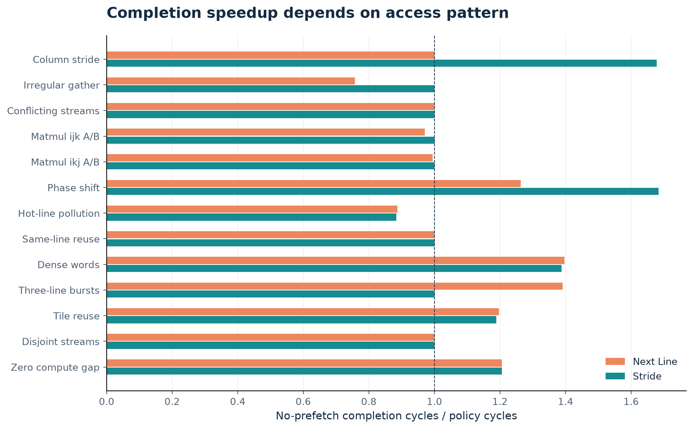
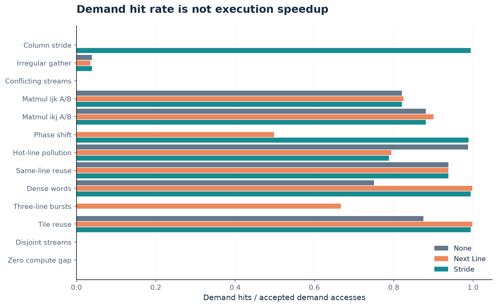
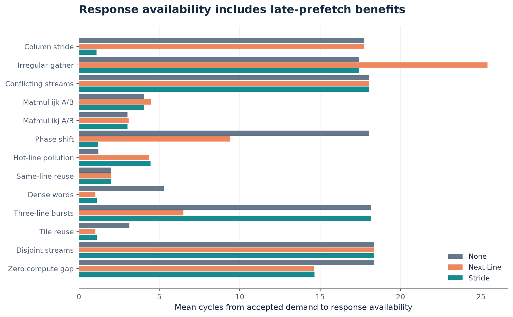
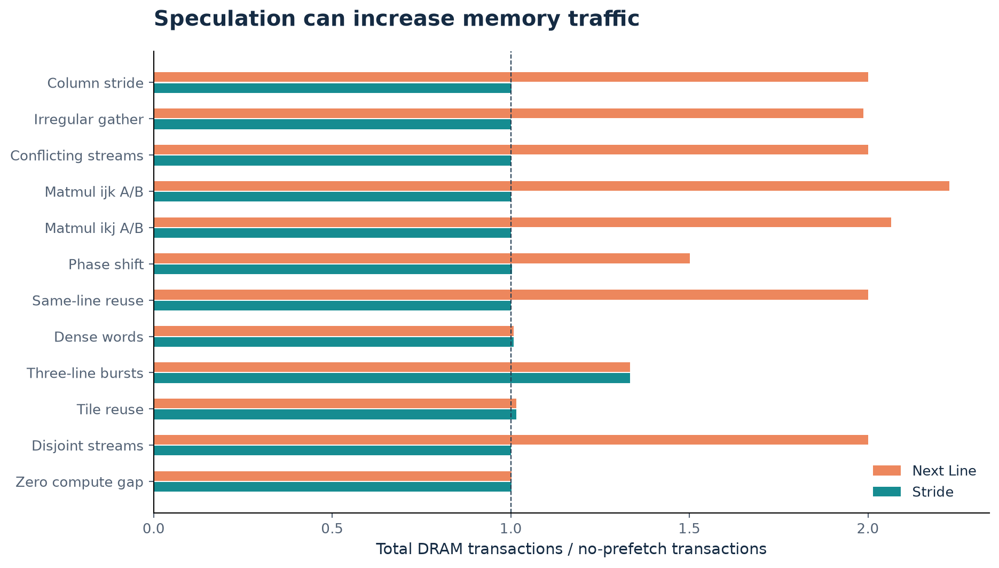
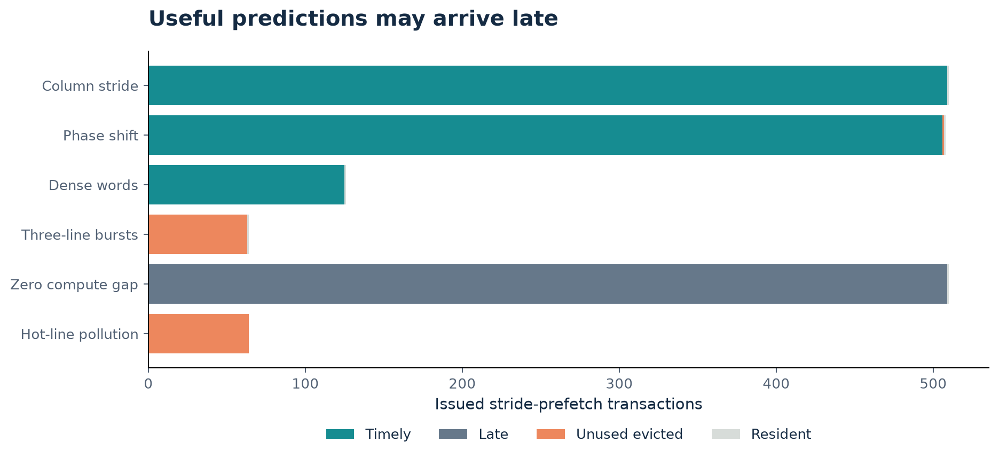
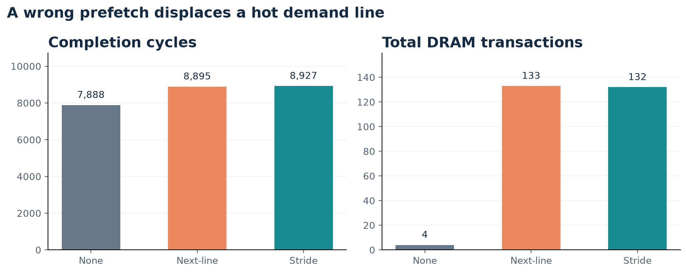
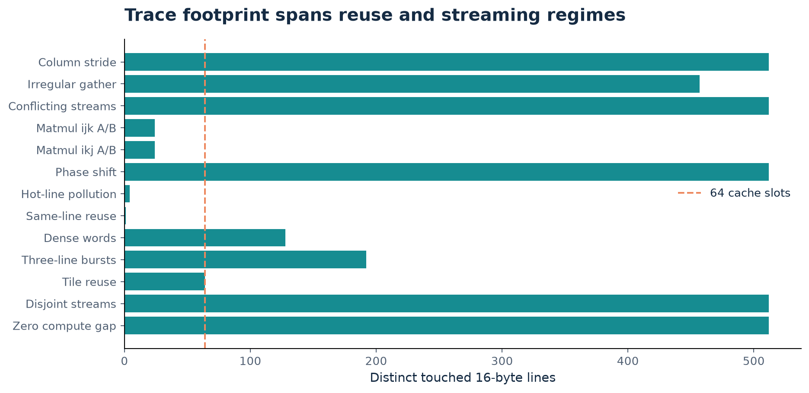
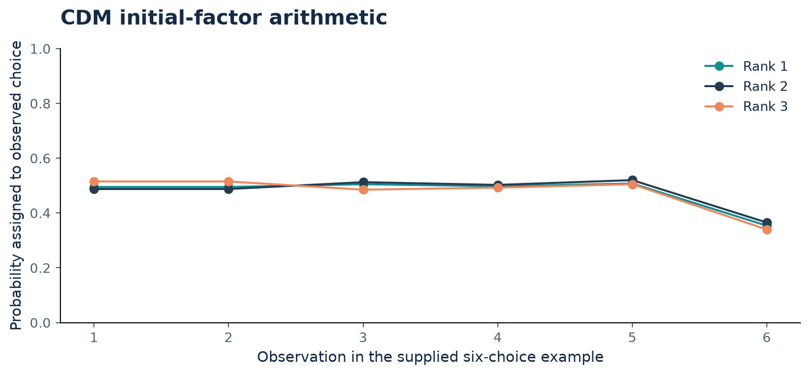
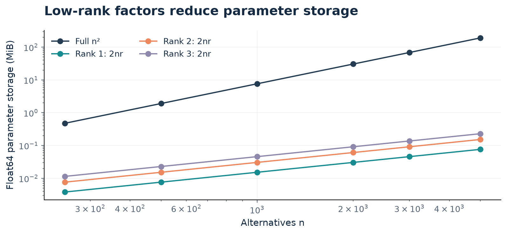

# Phase 1 figures

Each figure is supplied as PNG, PDF and SVG. Figures 01-07 derive from retained RTL/trace evidence. Figures 08-09 separately reproduce CDM illustration arithmetic and analytic storage.

## Completion speedup depends on access pattern; all 13 workloads, identical cache and timing.

Evidence: measured RTL.

## Demand hit rate is not execution speedup; all 13 workloads, identical cache and timing.

Evidence: measured RTL.

## Response availability includes late-prefetch benefits; all 13 workloads, identical cache and timing.

Evidence: measured RTL.

## Traffic ratio; pollution case shown separately to preserve the scale.

Evidence: measured RTL.

## Stride-prefetch outcomes conserve after natural quiescence.

Evidence: measured RTL.

## 320 demanded reads, four distinct demanded lines; all data correct despite the slowdown.

Evidence: measured RTL.

## Unique touched lines are a footprint measure, not a cache-capacity requirement.

Evidence: measured RTL.

## Supplied illustrative factors; not fitted models and not cache measurements.

Evidence: recalculated notes illustration.

## Analytic tensor storage excludes optimizer, gradients, data and temporary matrices.

Evidence: analytic storage.
