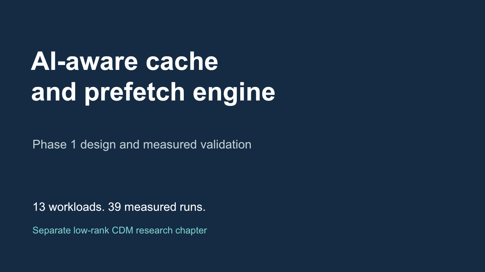

# Phase 1 presentation

[Open the 23-slide PowerPoint](phase1_presentation.pptx).

The deck includes design thinking, the five-level baseline, an editable architecture/control diagram, seven native editable data charts, measured result tables, verification, the separate low-rank CDM research proposal and the demonstration sequence. Speaker notes identify sources and scope.

The [composition source](source/build_deck.mjs) and [literal source dataset](source/source_data.json) support further editing. The source dataset derives from the retained benchmark CSV. Chart ratios use six decimal places for portable embedded workbooks; full precision remains in the original CSV. A first-party artifact-tool runtime authors/exports the slides. The PowerPoint itself can be edited without that authoring runtime.

The deck was rendered and visually inspected. It was not opened in desktop PowerPoint. CDM is research only, and no FPGA or real inference execution result is claimed.
