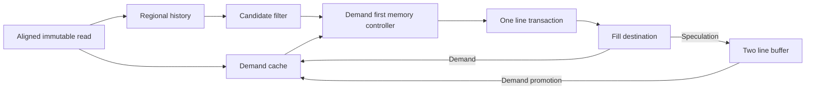

# Level 2 cache architecture

The final subsystem retains a1KiB direct-mapped demand cache with16-byte lines and adds two fully associative128-bit buffer entries. The predictor holds four4KiB region histories. [Level4](../level4/README.md) defines storage ownership, FSM and the executable interface. [The final report](../../Final/Hackathon_Report.pdf) gives the design rationale and resource breakdown.

Speculation enters the buffer, then promotes on demand. This removes speculative replacement of main-cache data. The victim-control configuration instead inserts displaced demand lines and swaps on a buffer hit. Both add32 data bytes, while metadata, comparators and control differ. The measured cost comparison uses a common Yosys tool and functional wrapper.

Demand data require8,192 bits, identities/valid require1,856 and the two buffer entries require314. Four regional histories require320 bits plus a two-bit replacement pointer and29 candidate bits. Controller and instrumentation state add further storage. No block RAM, timing or physical-area claim follows directly from these counts.

