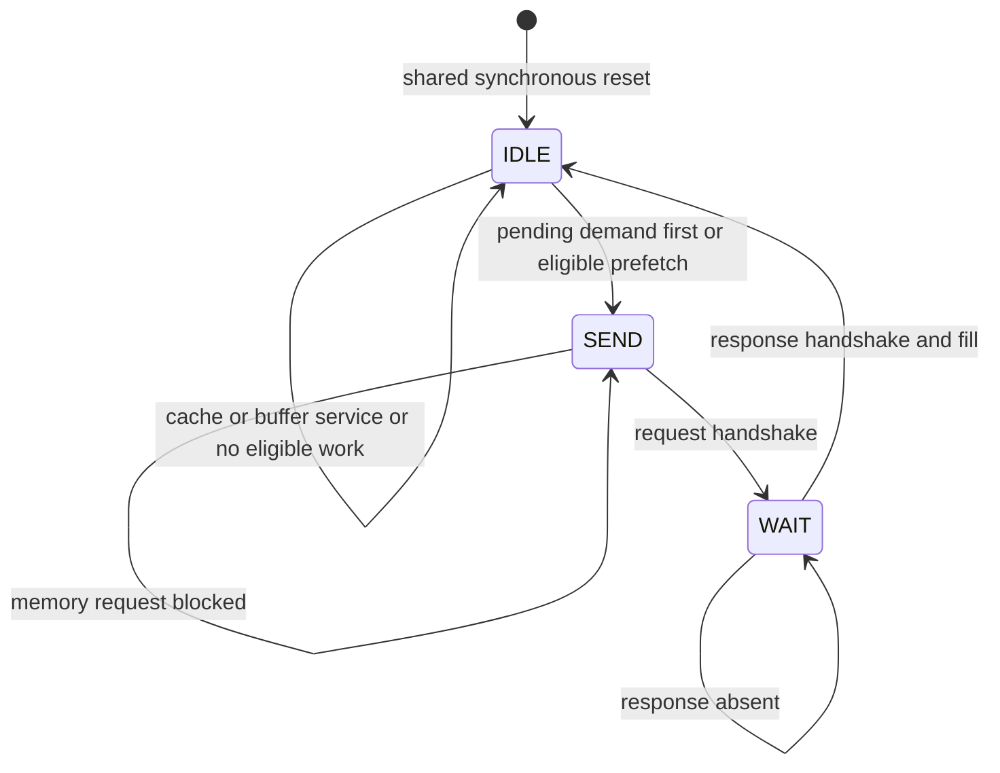

# Level 4 engineering implementation

The implementation is a read-only single-clock subsystem with a typed three-state SystemVerilog controller. A 1KiB direct-mapped demand cache shares one memory transaction slot with speculation. Two associative buffer entries isolate speculative fills from demand data. Regional history is bounded to four4KiB address regions. Compile-time ablations expose global history, region history, a global outcome gate, and a demand-only victim-buffer control.

## Run actual verification

```sh
# Repository root
python3 Phase2/level4/run_verification.py
python3 Phase2/level4/lint/run_checks.py
python3 Phase2/level4/synth/run_synthesis.py --yosys /path/to/yosys
```

The first suite runs directed tests and two seeds of continuous/adversarial traffic for all four configurations. Its protocol monitor checks exact legal FSM transitions, stable valid/payload under stalls, aligned memory transactions and one outstanding demand/one outstanding memory read. The second suite uses an independently written memory, driver and scoreboard in eight Icarus runs, plus a Verilator run with12 concurrent SystemVerilog properties. Each run resets both endpoints during SEND and WAIT, accounts for canceled demands and checks all returned words. Strict Verilator RTL lint has one narrow reviewed waiver for unused word-alignment bits.

Published evidence is in [reference](reference/). Finite simulation and synthesis CHECK success do not establish exhaustive correctness, coverage closure or target timing. [The AMD flow](vivado/README.md) supplies xsim and out-of-context characterization scripts but was not executed because Vivado is unavailable on the authoring host.

## FSM and transaction ownership



| State | Stable ownership and action | Exit condition |
|---|---|---|
| IDLE | Recheck a queued demand against cache and buffer before selecting memory. Pending demand wins over speculation. A newly accepted demand prevents speculative selection on that edge. | A selected transaction captures line and demand/prefetch identity. |
| SEND | Registered line and transaction identity drive memory valid/address. A later demand cannot cancel or replace that selected request. | Memory ready accepts the request. |
| WAIT | Only the selected transaction owns the memory response. Demand fills the main cache. Speculation fills the separate buffer. | Response valid completes the fill and returns to IDLE. |

Synchronous reset returns control to IDLE, clears response/candidate/pending state, resets counters and invalidates cache/buffer/predictor entries. Data and tag payload arrays retain arbitrary values behind cleared valid bits. Tests intentionally start those payloads unknown in Icarus. This avoids a mass data reset and does not imply block RAM inference: lookup remains combinational and a synchronous block RAM port would require a pipeline change.

The exact demand conservation bound is one. Acceptance requires no queued miss and an empty response register or concurrent consumption of its previous response. A miss blocks later acceptance until its response is queued. A hit queues one response immediately. The response and pending slot therefore cannot represent two independent unconsumed requests. Reset starts a new epoch and explicitly cancels any prior outstanding work at both endpoints.

## Buffer events and counter definitions

Only demand consumption promotes a speculative line into the main cache. Acceptance checks main cache first, then the buffer. During a selected speculative transaction, a demand may queue and later consume the returned line through the IDLE recheck. That is late consumption, not an initial hit. A selected SEND/WAIT request remains nonpreemptible, so an unrelated demand can wait behind it; the directed limitation test preserves this counterexample.

The fill edge blocks CPU acceptance to avoid conflicting array updates. Buffer promotion at acceptance and speculative replacement cannot occur on that same edge. A pending demand blocks new acceptance during its recheck. Cache and buffer duplicate filtering precedes speculative selection. Only one transaction exists, so an already selected transaction cannot race a second speculative issue. A registered advisory candidate may be dropped when an older pending slot is consumed; this loses an opportunity but not demand data.

`stat_hit` is main-cache-only. `stat_miss` includes timely buffer hits, so hits+misses=accesses. Immediate service rate adds `stat_buffer_hit` to main-cache hits. Initially unavailable demands equal misses-buffer_hits. Timely and late first consumption, unused buffer replacement and resident unresolved lines form disjoint prefetch fates after drain. The victim-control buffer contains demand evictions and has zero prefetch fates.

The global two-bit outcome gate increments on mature consumption, decrements on unused replacement and excludes unresolved resident lines. Its initial value is2 and it saturates at0/3. At zero it permits a probe after16 accepted demands; training continues through suppression. This heuristic is not a calibrated usefulness probability or a latency optimizer. Waste in one region can gate another. The validation rule selected region history without this gate because it added no validation benefit.

## FPGA and chip integration boundaries

The interface assumes aligned32-bit immutable reads, full128-bit responses, ordered single-outstanding memory and a shared synchronous reset. It supplies no writes, coherence, faults, IDs, AXI adapter, asynchronous clock crossings or stale-response cancellation protocol. An AXI integration needs a real adapter with protocol verification; renaming these ports AXI would be misleading. A board design needs clocks, synchronized startup, pin constraints and an actual memory controller.

No illegal-state fault recovery or single-event upset tolerance is certified. The default FSM branch returns to IDLE, but arbitrary state corruption can invalidate transaction ownership. The legal-state assertions detect it during verification. No formal liveness proof assumes an indefinitely stalled memory will respond; tests use bounded service and watchdogs.

Debug counters are32 bits and can wrap after long operation. Benchmark accumulators are64 bits, and all finite tests remain below the hardware wrap limit. Counters are instrumentation rather than a durable performance monitoring interface.
