# Final scientific figure gallery

18 measured/analytical figure families are defined in MATLAB-compatible source, with calculations executed in GNU Octave 11.3.0. Native MATLAB execution remains unverified. The FSM multi-axis figure uses a [Matplotlib export fallback](../analysis/render_fsm_fallback.py) from the same retained RTL signal samples because the local Octave/gnuplot multi-axis exporter stalled. Each PNG has a matching vector PDF. Full source and mathematical scope: [MATLAB](../matlab/README.md).

## Validation and held out

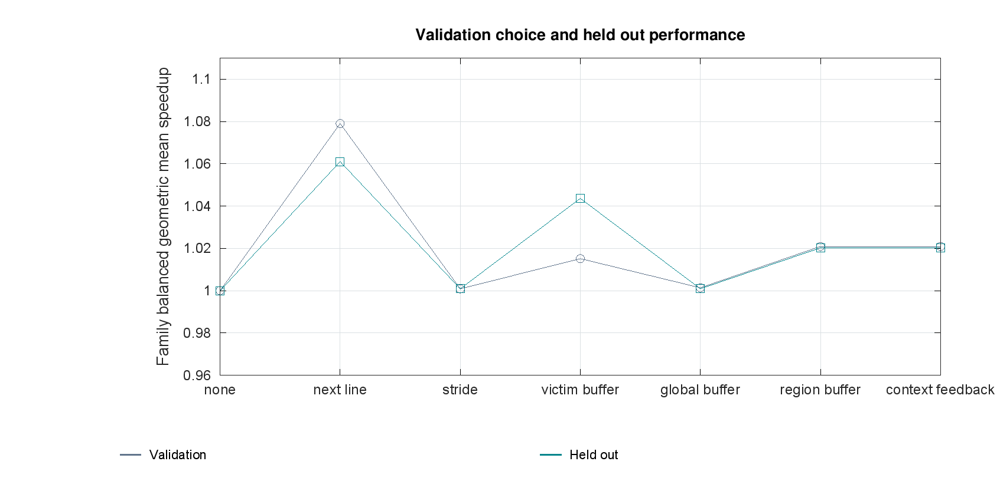

[Vector PDF](01_validation_and_held_out.pdf)

## Held out pareto

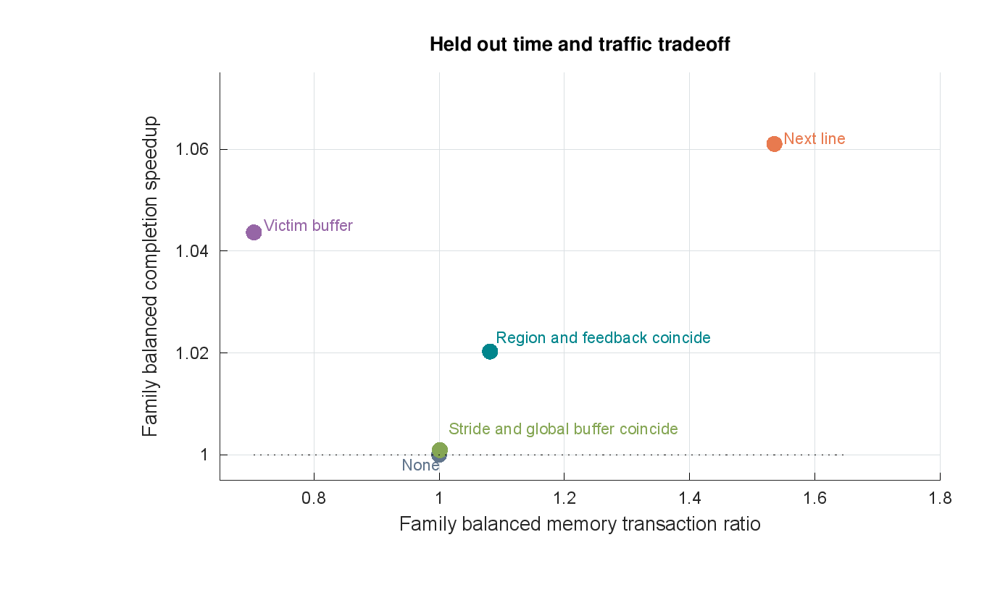

[Vector PDF](02_held_out_pareto.pdf)

## All case heatmap

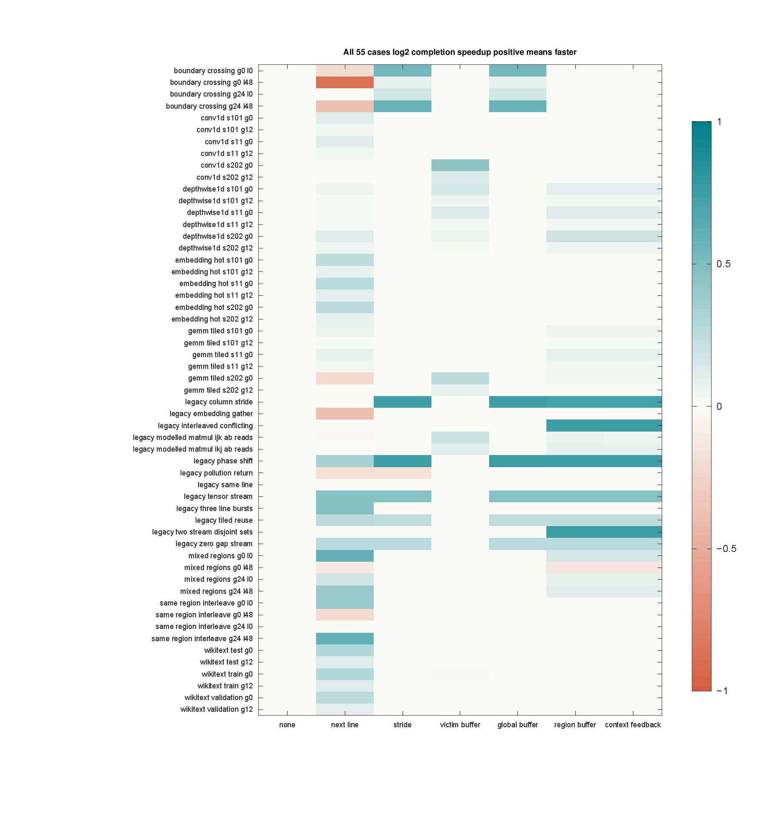

[Vector PDF](03_all_case_heatmap.pdf)

## Held out families

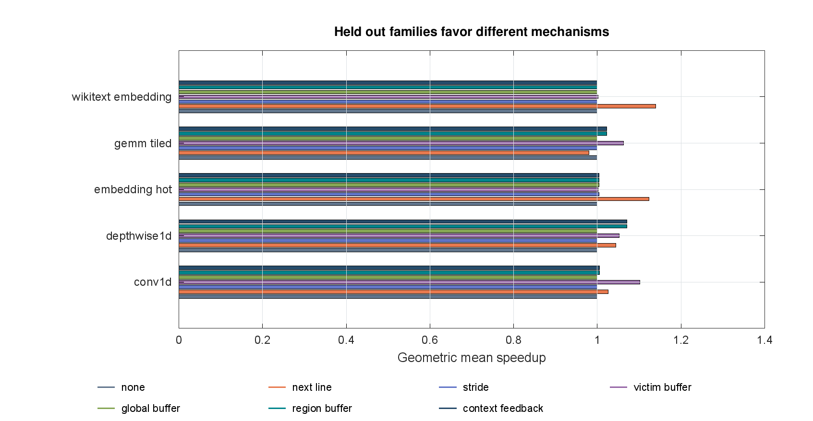

[Vector PDF](04_held_out_families.pdf)

## Case speedup distribution

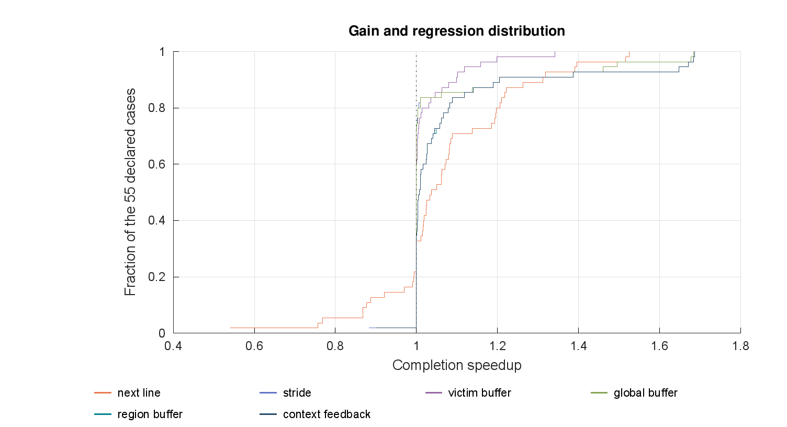

[Vector PDF](05_case_speedup_distribution.pdf)

## P95 offered latency

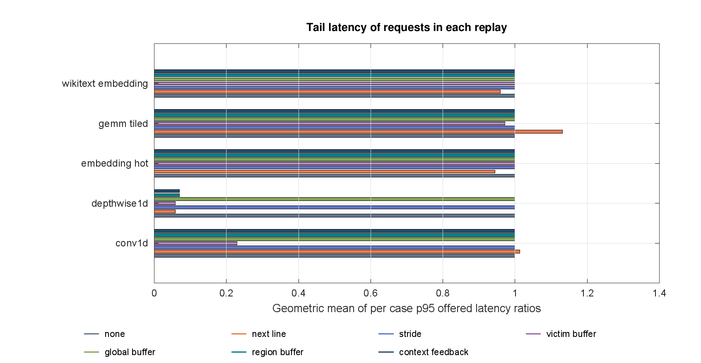

[Vector PDF](06_p95_offered_latency.pdf)

## Cache and service hits

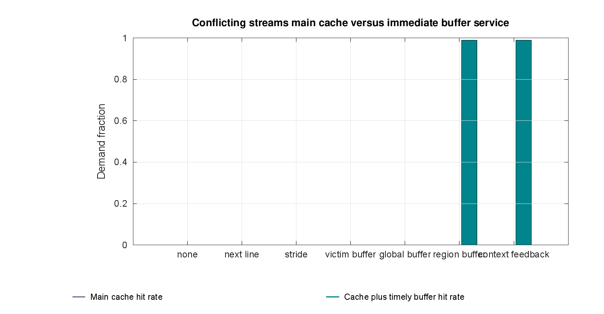

[Vector PDF](07_cache_and_service_hits.pdf)

## Prefetch fates

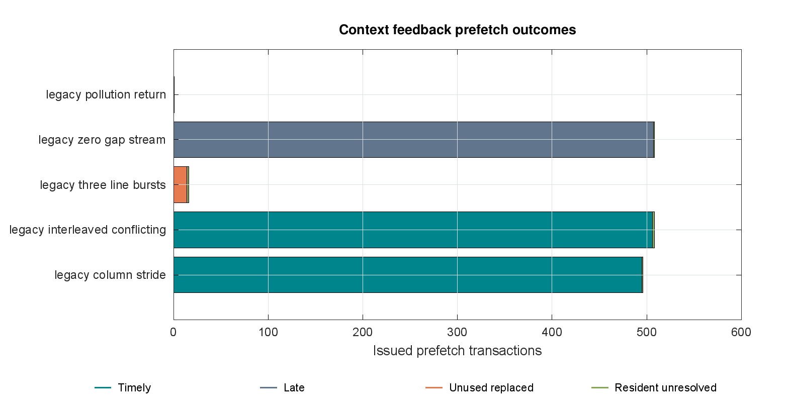

[Vector PDF](08_prefetch_fates.pdf)

## Pollution repair

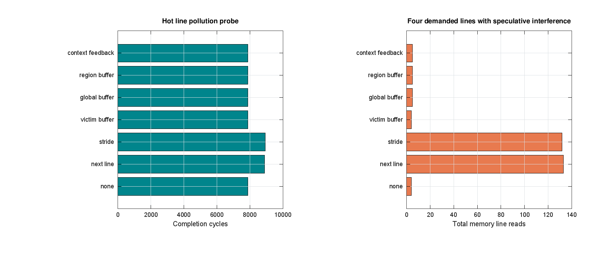

[Vector PDF](09_pollution_repair.pdf)

## Context counterexamples

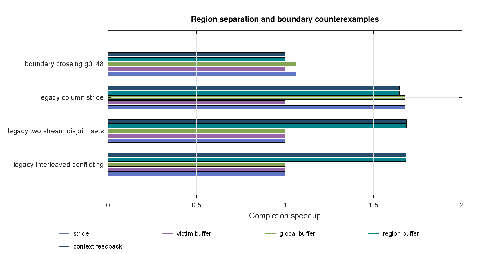

[Vector PDF](10_context_counterexamples.pdf)

## Timing and boundary stress

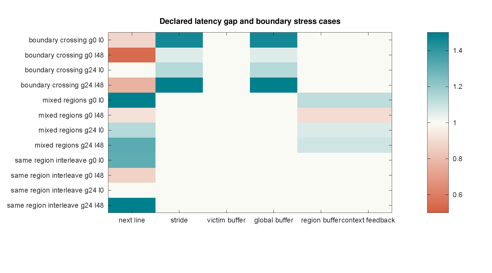

[Vector PDF](11_timing_and_boundary_stress.pdf)

## Feedback state and issues

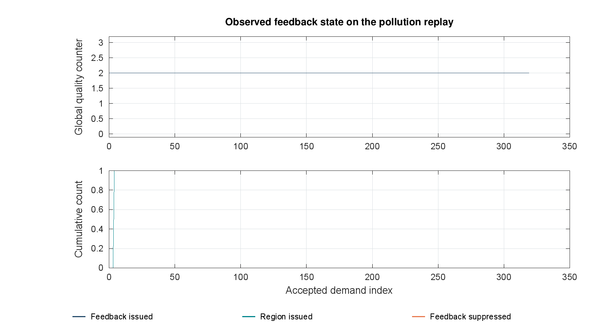

[Vector PDF](12_feedback_state_and_issues.pdf)

## Declared transaction cost sensitivity

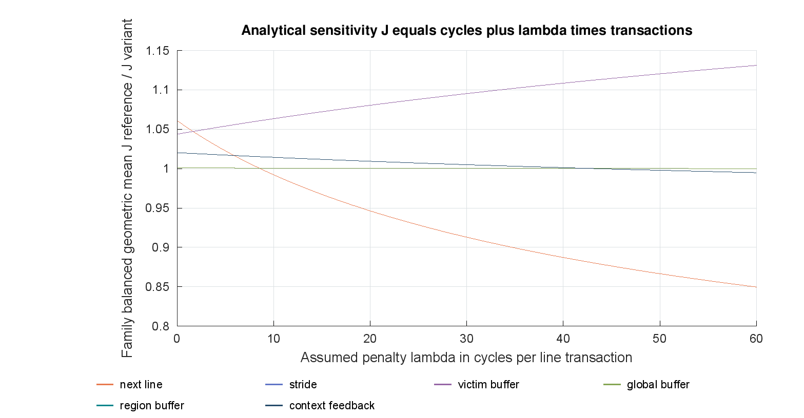

[Vector PDF](13_declared_transaction_cost_sensitivity.pdf)

## Probe sensitivity

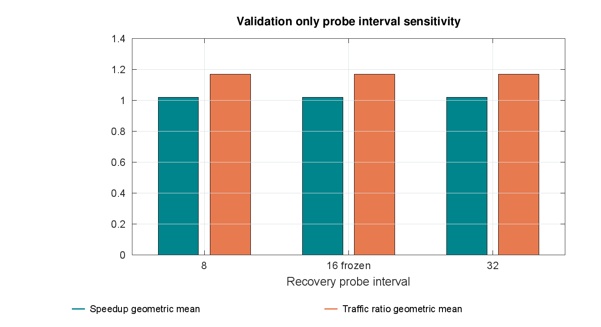

[Vector PDF](14_probe_sensitivity.pdf)

## Dataset coverage

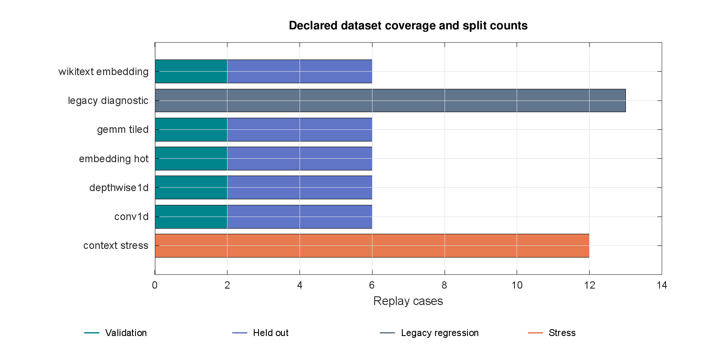

[Vector PDF](15_dataset_coverage.pdf)

## Incremental ablation

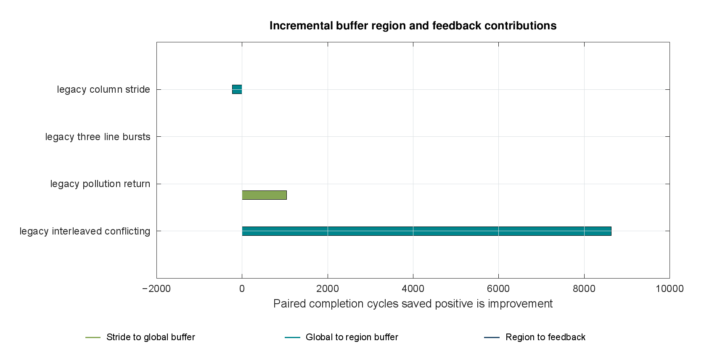

[Vector PDF](16_incremental_ablation.pdf)

## Fsm handshake trace

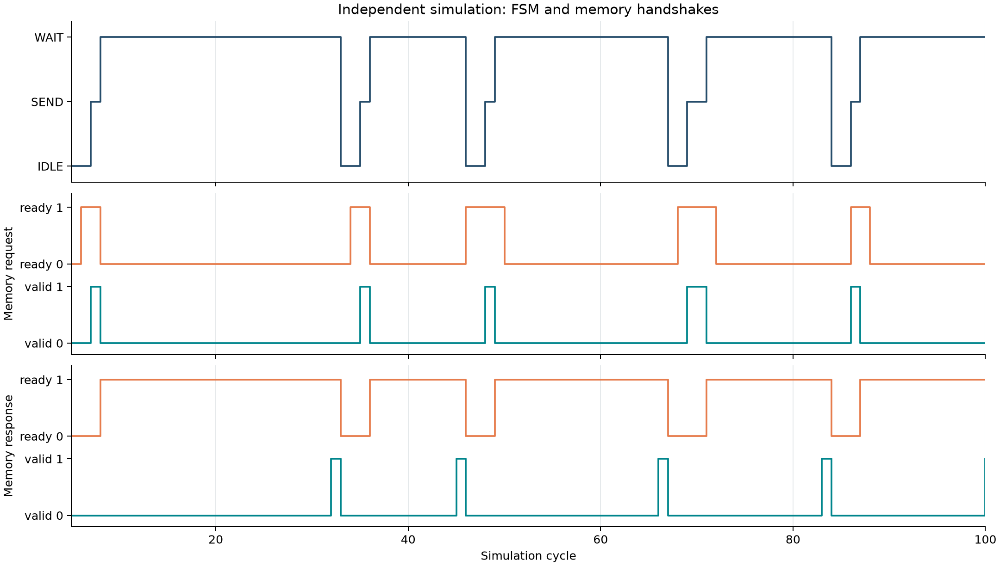

[Vector PDF](17_fsm_handshake_trace.pdf)

## Generic synthesis cost

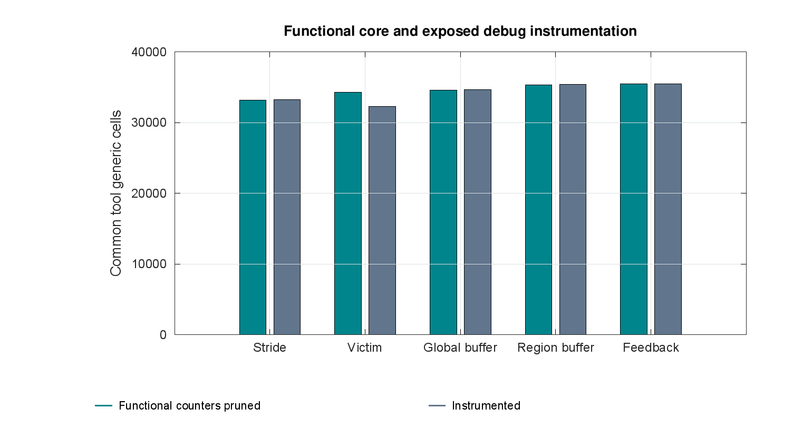

[Vector PDF](18_generic_synthesis_cost.pdf)
