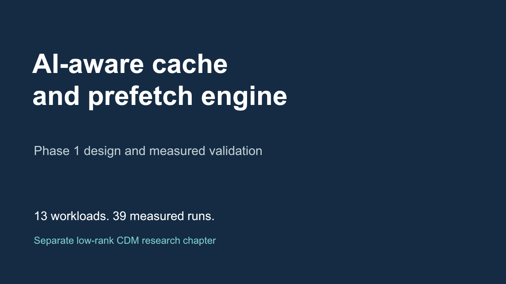

# AI Aware Cache and Prefetch Engine



**The current Phase 1 foundation is on `main`.** Every level includes substantive material to read, run and extend. The original `phase-1` branch remains available as the earlier baseline.

[PowerPoint presentation](Phase1/presentation/phase1_presentation.pptx) · [Technical report PDF](Phase1/report/phase1_report.pdf) · [Editable report](Phase1/report/phase1_report.docx) · [Figure gallery](Phase1/level5/plots/README.md)

## Start with a level

| Level | Read | Run or explore |
|---|---|---|
| 1 Memory trace analysis | [Analysis and modelled matmul](Phase1/level1/README.md) | [Original executed notebook](Phase1/level1/matmul_analysis.ipynb) |
| 2 Cache architecture | [Decisions, diagram and address example](Phase1/level2/README.md) | [Cache model notebook](Phase1/level2/cache_architecture.ipynb) |
| 3 Prefetch strategy | [State, pseudocode and failure cases](Phase1/level3/README.md) | [Predictor walkthrough](Phase1/level3/prefetch_walkthrough.ipynb) |
| 4 RTL implementation | [Actual modules and protocol](Phase1/level4/README.md) | [RTL walkthrough and tests](Phase1/level4/rtl_walkthrough.ipynb) |
| 5 Performance validation | [Measured results and formulas](Phase1/level5/README.md) | [Results notebook](Phase1/level5/results_walkthrough.ipynb) |

## Reproduce the baseline

```sh
make all
make notebooks
make synth
```

The core uses Python 3.10+, GNU Make, Icarus Verilog and VVP. Synthesis additionally requires Yosys. The current suite passes 38 Python tests and checks 32,637 RTL responses, including 39 measured runs across 13 traces and three policies.

For figures, create a plotting environment and install [the optional requirements](Phase1/requirements-figures.txt), then run `make figures` with that environment's Python. [MATLAB plotting source](Phase1/level5/matlab/README.md) is supplied; published figures were generated with Python because MATLAB was unavailable.

## Understand the results

[The complete measured report](Phase1/level5/results/reference/report.md) retains no-prefetch, next-line and stride results. [The interpretation guide](Phase1/level5/results/reference/interpretation.md) explains every workload, including pollution and cases with no gain. These are synthetic/modelled subsystem experiments, not measured application acceleration or physical DRAM timing.

## Separate CDM research

[The low-rank CDM chapter](Phase1/research/cdm/README.md) reproduces the supplied notes' formulas and illustrative arithmetic, distinguishes storage from runtime memory and proposes a future context-policy connection. [Its executed notebook](Phase1/research/cdm/cdm_walkthrough.ipynb) is separate from the implemented cache RTL.

Nitesh's [Level 1 source history](Phase1/docs/PROVENANCE.md) is preserved. Future buffer/feedback enhancements remain in the [Phase 2 roadmap](Phase1/docs/PHASE2_ROADMAP.md). No algorithmic novelty, FPGA validation or competition outcome is guaranteed.
